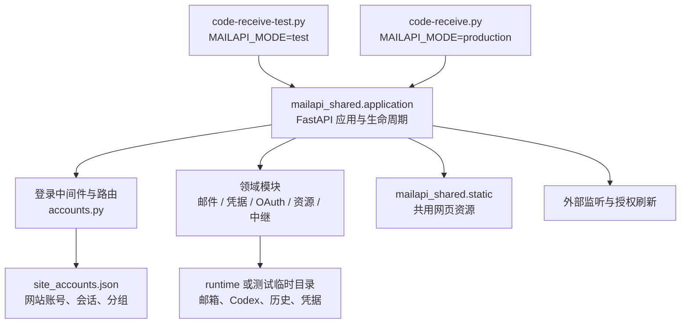

# MailAPI 架构说明

这份文档说明正式版和测试版的共同边界。它回答三个问题：代码在哪里、运行数据在哪里、一次改动如何从测试版进入正式版。

## 总体结构



两个入口文件只负责选择模式和调用 `run()`。业务路由、登录中间件、启动钩子和外部监听都在
`mailapi_shared/application.py` 中注册；这保证正式版和测试版调用同一份实现。

## 代码目录

| 位置 | 职责 | 是否直接修改 |
| --- | --- | --- |
| `mailapi_shared/application.py` | 模式配置、FastAPI 应用、登录中间件、业务路由、启动/停止监听 | 是，当前的应用编排层 |
| `mailapi_shared/accounts.py` | 用户名密码登录、会话 cookie、网站账号和分组 API | 是 |
| `mailapi_shared/site_accounts.py` | 密码哈希、会话、角色、分组授权存储 | 是 |
| `mailapi_shared/account_*`、`mailapi_shared/auth_storage.py` | 共享凭据、密码和授权文件操作 | 是 |
| `mailapi_shared/mail_*`、`mail_providers/` | 邮件解析、Gmail/Outlook/Proton 和中继 | 是 |
| `mailapi_shared/resource_accounts.py` | Coding Plan 和中转站资源 | 是 |
| `mailapi_shared/*_oauth_callback.py` | Google/Codex OAuth 返回链接解析与校验 | 是 |
| `mailapi_shared/static/` | 正式版和测试版共用的 HTML/CSS/JS | 是 |
| `code-receive.py`、`code-receive-test.py` | 正式/测试模式入口 | 只在模式选择变化时修改 |
| 根目录同名模块 | 正式版历史导入路径的兼容别名 | 不放新业务逻辑 |
| `test_app/services/`、`test_app/main.py` | 测试版历史导入路径的兼容别名 | 不放新业务逻辑 |
| `scripts/` | 手工授权、Proton 和中继运维工具 | 按脚本职责修改 |
| `tests/` | Python 和前端回归测试 | 与功能改动一起更新 |

根目录的兼容模块很短，真正实现应放在 `mailapi_shared/`。`static/` 和 `test_app/static/`
是指向 `mailapi_shared/static/` 的兼容链接，避免出现两份网页代码。

`application.py` 目前仍然是较大的编排文件。它集中管理路由和生命周期，便于保持两版一致；
后续若继续拆分，应按“配置、网站账号路由、资源路由、邮箱监听、Codex 监听”拆分，并保持
入口只调用同一应用对象，不能重新产生正式/测试两套业务实现。

## 运行模式边界

| 项目 | 正式版 | 测试版 |
| --- | --- | --- |
| 入口 | `code-receive.py` | `code-receive-test.py` |
| 模式变量 | `MAILAPI_MODE=production` | `MAILAPI_MODE=test` |
| 默认端口 | `8000` | `8001` |
| 默认主机 | `0.0.0.0` | `127.0.0.1` |
| 数据目录 | `runtime/`，可用 `MAILAPI_DATA_DIR` 覆盖 | 默认创建临时快照，可用 `TEST_DATA_DIR` 指定独立目录 |
| 网站账号 | `runtime/site_accounts.json` | 临时目录中的 `site_accounts.json` |
| 外部监听 | `MAILAPI_EXTERNAL_WATCHERS`，默认开启 | `TEST_EXTERNAL_WATCHERS`，默认关闭 |
| 初始化管理员 | `ADMIN_ACCESS_PASSWORD`，回退 `ACCESS_PASSWORD` | `TEST_ADMIN_PASSWORD` |
| OAuth/回调配置 | 正式环境变量 | `TEST_*` 配置或独立回调地址 |

测试启动时从正式 `runtime/` 复制邮箱、Codex、凭据、历史和规则数据，故测试可以使用真实数据
形状模拟操作；它会跳过正式网站账号、正式中继密钥和 `runtime/test/`。测试版的写入只进入
快照，默认进程退出即删除。测试网站账号、分组和会话不是发布物，也不会自动同步到正式版。

两版都使用用户名加密码登录。正式版额外保留旧访问口令、请求头和 cookie 的兼容读取，便于
已有部署平滑过渡；这不改变新网站账号的权限模型。

## 请求和权限流程

1. 请求进入共享 FastAPI 应用，`access_guard` 读取网站会话 cookie，并校验跨站请求来源。
2. 登录接口由 `accounts.py` 处理；成功后只把随机会话 token 放入 cookie，服务端保存 token 摘要。
3. 路由根据用户角色判断是否需要管理员权限。
4. 资源、邮箱、验证码历史、密码和 2FA 读取统一经过账号/分组授权检查。
5. 管理员修改网站账号或分组后，后续请求立即使用新权限；修改密码、退出、删除账号会撤销相关会话。

业务资源和网站身份是两类数据：邮箱/Codex 关联属于运行资源，网站账号和分组属于访问控制。
测试快照复制前者，不复制后者，避免测试账号意外获得正式账号会话。

## 数据和文件边界

代码同步时可以覆盖：Python 模块、静态资源、测试、README 和 `docs/`。

部署时必须保留服务器自己的：

- `.env`、`.env.test` 和 OAuth 客户端配置；
- `runtime/` 下的邮箱、Codex、token、历史、凭据、网站账号和日志；
- 服务器的虚拟环境和进程管理配置。

`runtime/` 被 Git 忽略，不应通过代码同步命令覆盖。测试数据即使来自正式快照，也只用于验证
代码行为；测试数据不是迁移正式数据的工具。

## 测试、发布和回退

每次功能改动按下面顺序执行：

1. 在 `mailapi_shared/` 修改共享逻辑；入口只在确实需要改变模式配置时修改。
2. 先启动测试版，确认登录、路由、权限、资源列表和失败路径。默认关闭外部监听，避免消费真实邮件或刷新正式授权。
3. 运行 Python 和前端回归测试，并检查两入口都能导入共享应用。
4. 创建一个只包含本次改动的 Git 提交。
5. 同步代码和文档到服务器，排除 `.env`、`runtime/`、凭据和虚拟环境。
6. 在服务器 Conda 环境运行 Python 回归；确认每个端口只有一个服务进程，再按需要重启正式版。
7. 用登录页、`/api/auth/me`、`/api/accounts` 和一个管理员接口做健康检查。

建议使用一个进程管理方式，不要同时用 tmux、终端前台和 `nohup` 启动同一端口。排查时先看：

```bash
pgrep -af 'code-receive(-test)?\.py'
ss -ltnp | grep -E ':(8000|8001)\b'
```

停止服务应先发送 `SIGTERM`，确认端口释放后再启动新版本：

```bash
kill -TERM <pid>
```

回退只回退代码提交，不删除 `runtime/`。回退后仍需重新运行测试和健康检查；如果数据格式发生
变更，应先确认旧版本能读取当前运行数据，再执行回退。

## 当前设计的限制

- JSON 文件是单进程存储，不能直接扩展为多个 Uvicorn worker。
- 测试网站账号默认不持久化；需要跨进程保留时必须显式设置独立 `TEST_DATA_DIR`，且不能指向正式 `runtime/`。
- OAuth 回调和邮箱监听属于外部状态，测试时必须使用独立账号、回调端口和 token。
- 兼容别名保留是为了旧导入路径，不应在别名文件中新增业务逻辑。
