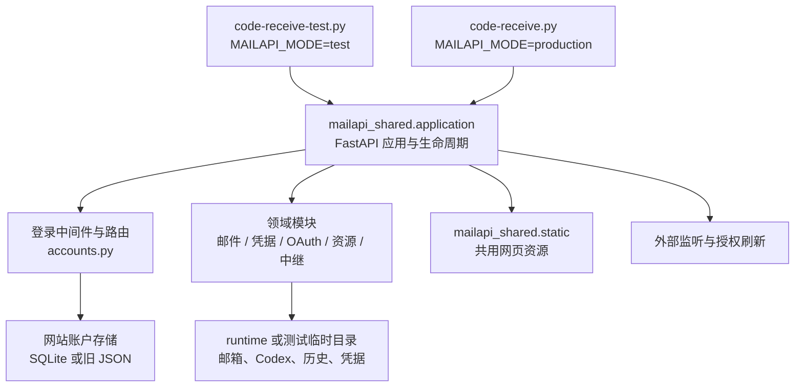

# MailAPI 架构说明

这份文档说明正式版和测试版的共同边界。它回答三个问题：代码在哪里、运行数据在哪里、一次改动如何从测试版进入正式版。

## 总体结构



两个入口文件只负责选择模式和调用 `run()`。业务路由、登录中间件、启动钩子和外部监听都在
`mailapi_shared/application.py` 中注册；这保证正式版和测试版调用同一份实现。

## 代码目录

| 位置 | 职责 | 是否直接修改 |
| --- | --- | --- |
| `mailapi_shared/application.py` | 模式配置、FastAPI 应用、登录中间件、业务路由、启动/停止监听 | 是，当前的应用编排层 |
| `mailapi_shared/accounts.py` | 用户名密码登录、会话 cookie、网站账号和分组 API | 是 |
| `mailapi_shared/site_accounts.py` | 密码哈希、会话、角色、分组授权存储 | 是 |
| `mailapi_shared/account_*`、`mailapi_shared/auth_storage.py` | 共享凭据、密码和授权文件操作 | 是 |
| `mailapi_shared/subscription_dates.py` | ID Token 订阅到期日期解析与账号绑定 | 是 |
| `mailapi_shared/codex_tip_content.py` | 提示图文格式校验、图片转 WebP 和私有图片路径 | 是 |
| `mailapi_shared/mail_*`、`mail_providers/` | 邮件解析与 Gmail/Outlook 授权 | 是 |
| `mailapi_shared/resource_accounts.py` | Coding Plan 和中转站资源 | 是 |
| `mailapi_shared/*_oauth_callback.py` | Google/Codex OAuth 返回链接解析与校验 | 是 |
| `mailapi_shared/static/` | 正式版和测试版共用的 HTML/CSS/JS | 是 |
| `code-receive.py`、`code-receive-test.py` | 正式/测试模式入口 | 只在模式选择变化时修改 |
| 根目录同名模块 | 正式版历史导入路径的兼容别名 | 不放新业务逻辑 |
| `test_app/services/`、`test_app/main.py` | 测试版历史导入路径的兼容别名 | 不放新业务逻辑 |
| `scripts/` | 手工授权与运维工具 | 按脚本职责修改 |
| `tests/` | Python 和前端回归测试 | 与功能改动一起更新 |

根目录的兼容模块很短，真正实现应放在 `mailapi_shared/`。`static/` 和 `test_app/static/`
是指向 `mailapi_shared/static/` 的兼容链接，避免出现两份网页代码。

`application.py` 目前仍然是较大的编排文件。它集中管理路由和生命周期，便于保持两版一致；
后续若继续拆分，应按“配置、网站账号路由、资源路由、邮箱监听、Codex 监听”拆分，并保持
入口只调用同一应用对象，不能重新产生正式/测试两套业务实现。

## 运行模式边界

| 项目 | 正式版 | 测试版 |
| --- | --- | --- |
| 入口 | `code-receive.py` | `code-receive-test.py` |
| 模式变量 | `MAILAPI_MODE=production` | `MAILAPI_MODE=test` |
| 新版工作台、财务和 API | `MAILAPI_WORKSPACE_ENABLED=1` 时注册，默认关闭 | 默认注册 |
| 默认端口 | `8000` | `8001` |
| 默认主机 | `127.0.0.1`，公网通过可信反代接入 | `127.0.0.1`，仅允许回环 |
| 数据目录 | `runtime/`，可用 `MAILAPI_DATA_DIR` 覆盖 | 启动时从 `runtime/` 创建隔离快照，可用 `TEST_DATA_DIR` 指定空的快照目录 |
| 网站账号 | 显式启用时使用 `site_accounts.sqlite3`，默认使用 `site_accounts.json` | 默认使用临时 JSON，可在独立数据目录启用 SQLite |
| 外部监听 | `MAILAPI_EXTERNAL_WATCHERS`，默认开启 | `TEST_EXTERNAL_WATCHERS`，默认关闭 |
| 初始化管理员 | 离线配置密码和 TOTP | `TEST_ADMIN_PASSWORD` |
| OAuth/回调配置 | 正式环境变量 | `TEST_*` 配置或独立回调地址 |

测试启动时从正式 `runtime/` 复制邮箱、Codex、凭据、历史、规则、网站账户和分组数据，故测试可以使用真实数据
形状模拟操作；会话摘要、正式邮件中继密钥和 `runtime/test/` 不会复制。测试版的写入只进入
快照，默认进程退出即删除。测试快照中的网站账户密码和资源授权只供隔离验证，不会自动同步到正式版。

两版都使用网站账号会话。正式版的 admin 和普通管理员还需要一次性 TOTP 验证码。

`workspace_config.py` 只决定新版界面与功能路由是否启用，不改变运行模式。
正式工作台继续使用正式数据库、加密密钥及登录规则，测试版继续使用独立快照和测试配置；
两版不会因开关而互相导入数据。工作台的额外 Python 依赖列在 `requirements-workspace.txt`，
正式入口和进程管理方式无需改成测试入口。

## 请求和权限流程

1. 公网请求先由 `web_security.py` 校验反代连接，再由共享应用读取会话 cookie 和校验请求来源。
2. 登录接口由 `accounts.py` 处理；成功后只把随机会话 token 放入 cookie，服务端保存 token 摘要。
3. 路由根据用户角色判断是否需要管理员权限。
4. 资源、邮箱、验证码历史、密码和 2FA 读取统一经过账号/分组授权检查。
5. 管理员修改网站账号或分组后，后续请求立即使用新权限。角色变更、修改密码、退出和删除账号会撤销相关会话。

业务资源和网站身份是两类数据：邮箱/Codex 关联属于运行资源，网站账号和分组属于访问控制。
测试快照复制前者，不复制后者，避免测试账号意外获得正式账号会话。

GPT 账号与邮箱池分别持久化。`account_credentials.py` 保存 GPT 登录名、稳定资源标识、可选凭据和
显式邮箱绑定；`gmail_accounts.json` 继续管理各提供商授权和监听生命周期。一个 GPT 账号可绑定多个
邮箱，同一邮箱仅有一个 GPT 所有者，绑定更新在凭据存储锁内检查并原子写入。绑定同时核对邮箱编号
和实际地址，防止删除后复用编号造成权限串联。普通用户通过 GPT 分组授权访问当前绑定邮箱的 OpenAI 验证码和历史。
邮箱还可独立上架为 `mailbox:<resource_id>` 资源，使用随机稳定标识并按组分配，独立授权允许查看全部
收件规则的捕获结果。两类权限取并集，邮箱上架状态与监听启停分别保存；只读邮箱权限不授予 GPT 凭据访问。

首次升级沿用原 `email:...` 资源标识，保留分组权限并迁移原同名邮箱绑定；之后新增邮箱不再创建 GPT
账号。新 GPT 使用随机稳定标识，改名保持资源权限，删除后重建不继承权限。Codex 的外部邮箱身份单独
记录，GPT 改名不会改变其 Codex 归属。`static/management-tabs.*` 共用于账号与分组页及四个资源池面板。

## 数据和文件边界

正式版采用混合存储。SQLite 保存需要事务、权限关联和结构化查询的数据。加密文件保存 OAuth
授权、客户端配置、图片、日志和接码历史等文件型数据。数据库中的文件路径、资源 ID、版本号
和加密状态只用于关联和恢复，不代表文件内容已经写入数据库。

| 类别 | 当前存储 | 备份要求 |
| --- | --- | --- |
| 网站账户、会话、分组、成员、资源授权 | `site_accounts.sqlite3` | 与资源库和代码版本配套 |
| GPT 资料、资源池元数据、修改记录 | `resources.sqlite3` | 与 `resource_secrets/` 配套 |
| GPT 密码、2FA、API Key、恢复点 | SQLite 中的加密字段和加密恢复表 | 必须保留正式凭据密钥 |
| Gmail、Outlook、Codex OAuth 与历史副本 | 加密文件目录 | 必须保留 OAuth 密钥和相对目录结构 |
| Google、Outlook 客户端配置 | 加密的 `oauth_clients.json` | 必须保留 OAuth 密钥 |
| 收件规则、接码历史、历史游标 | JSON 文件和历史目录 | 与邮箱资源及保留策略配套 |
| Codex 图文提示、图片、错误日志 | JSON、WebP 和日志文件 | 按文件权限和保留期备份 |
| 财务申请、历史、公告、通知、本站 API 关联与本地用量 | 启用工作台后的 `test_features.sqlite3`，位于当前模式的数据目录 | 与 `finance_files/`、凭据密钥及独立 NewAPI 数据库配套 |

旧版 JSON 只作为历史迁移或回滚材料，不作为正式版当前数据源。切换完成后，旧明文副本应移出
运行目录并使用加密归档保存。

代码同步时可以覆盖：Python 模块、静态资源、测试、README 和 `docs/`。

部署时必须保留服务器自己的：

- `.env`、`.env.test` 和 OAuth 客户端配置；
- `runtime/` 下的邮箱、Codex、token、历史、凭据、网站账号和日志；
- 服务器的虚拟环境和进程管理配置。

`runtime/` 被 Git 忽略，不应通过代码同步命令覆盖。测试数据即使来自正式快照，也只用于验证
代码行为；测试数据不是迁移正式数据的工具。

## 测试、发布和回退

每次功能改动按下面顺序执行：

1. 在 `mailapi_shared/` 修改共享逻辑；入口只在确实需要改变模式配置时修改。
2. 先启动测试版，确认登录、路由、权限、资源列表和失败路径。默认关闭外部监听，避免消费真实邮件或刷新正式授权。
3. 运行 Python 和前端回归测试，并检查两入口都能导入共享应用。
4. 创建一个只包含本次改动的 Git 提交。
5. 同步代码和文档到服务器，排除 `.env`、`runtime/`、凭据和虚拟环境。
6. 在服务器 Conda 环境运行 Python 回归；确认每个端口只有一个服务进程，再按需要重启正式版。
7. 用登录页、`/api/auth/me`、`/api/accounts` 和一个管理员接口做健康检查。

建议使用一个进程管理方式，不要同时用 tmux、终端前台和 `nohup` 启动同一端口。排查时先看：

```bash
pgrep -af 'code-receive(-test)?\.py'
ss -ltnp | grep -E ':(8000|8001)\b'
```

停止服务应先发送 `SIGTERM`，确认端口释放后再启动新版本：

```bash
kill -TERM <pid>
```

回退只回退代码提交，不删除 `runtime/`。回退后仍需重新运行测试和健康检查；如果数据格式发生
变更，应先确认旧版本能读取当前运行数据，再执行回退。

## 当前设计的限制

最近一次站点入口、依赖及运行稳定性检查见[安全与稳定性检查](security-review.md)，其中包含尚未修复和未核实的边界。

- JSON 文件是单进程存储，不能直接扩展为多个 Uvicorn worker。
- 测试网站账号默认不持久化；需要跨进程保留时必须显式设置独立 `TEST_DATA_DIR`，且不能指向正式 `runtime/`。
- OAuth 回调和邮箱监听属于外部状态，测试时必须使用独立账号、回调端口和 token。
- 兼容别名保留是为了旧导入路径，不应在别名文件中新增业务逻辑。

## SQLite 网站账户迁移

网站账户、会话、分组、成员和资源分配可显式迁移到 SQLite。迁移保留排序、ID、密码哈希、TOTP 状态与会话摘要。数据库校验完整性、外键和导入前后的数据一致性后才发布。应用事务只写修改过的数据库记录，继续采用单服务进程。

OAuth 授权、图文文件、接码历史和日志继续使用加密文件。分组资源键保留现有资源池的标识，包括因资源被移除而暂时无法解析的键。迁移和备份步骤见[环境说明](environment.md#网站账户迁移到-sqlite)。

## SQLite 资源元数据迁移

GPT 资料与修改记录、Coding Plan、中转站、邮箱池、Codex 资源元数据可迁入 `resources.sqlite3`。资源标识与顺序保留，分组仍通过原标识分配。密码、2FA、API Key 和 GPT 恢复点使用 SQLite 中的加密字段和恢复表，OAuth 令牌缓存及授权文件继续使用加密文件。操作步骤见[资源元数据迁移](environment.md#资源元数据迁移到-sqlite)。

## 隔离测试版凭据加密

显式启用时，管理员 2FA 密钥、GPT 密码和 2FA 密钥、Coding Plan API Key、中转站密码及 GPT 账号字段恢复点使用 AES-256-GCM 加密后存入对应 SQLite 库。网站密码沿用加盐哈希。带版本和密钥 ID 的密文使用独立随机 nonce，鉴别数据绑定测试环境、资源 ID、字段和恢复事件 ID。历史接口继续返回审计描述和可恢复字段。

OAuth 授权、Codex 令牌缓存及其原有 Fernet 恢复点沿用现有文件和密钥。两个 SQLite 库都保存加密标记，启动和备份恢复需要匹配的密钥。迁移与密钥轮换在独立的新目录生成两份数据库，校验后才发布。迁移、轮换和备份操作见[测试版凭据加密演练](environment.md#测试版凭据加密演练)。

## 隔离测试版 OAuth 文件加密

设置 `TEST_OAUTH_ENCRYPTION=1` 后，Gmail 授权、Outlook MSAL 缓存、Codex 授权和三类历史副本继续按原目录存放，文件内容使用 AES-256-GCM 加密。关联数据绑定相对路径，整个运行目录可备份恢复，单个文件归档或移动时会在内存解密后按新路径重新加密。资源库的私有文件同样加密，覆盖 Codex 令牌缓存与资源库内的历史恢复点。客户端配置独立管理。

Gmail 和 Outlook 从内存加载授权，续期后保存加密结果。Codex 刷新先保存包含前一令牌指纹的文件，再持久化资源库。如进程在两步间中断，重启时可以补回本次轮换。操作步骤见[隔离测试版 OAuth 加密演练](environment.md#隔离测试版-oauth-加密演练)。

## 待实现设计

### 统一内容编辑与界面体验（测试版已实现）

- Codex 使用提示、网站公告和财务公告共用 Tiptap 编辑器、图片操作、阅读预览及未保存关闭提醒，保留各自业务入口与权限。正文最多 8000 字，图片沿用现有限制，公告不新增自动草稿。
- 公告增加可空的结构化正文和版本字段；旧纯文本不批量改写，主动编辑保存后才转换，单独置顶保持原正文。图片按网站/财务范围存储，服务端校验本站图片与内容类型；读取需要登录。并发编辑冲突返回提示。
- 资源页新增状态筛选和额度/到期排序；多授权工作区至少一个可用即属于可用，任一个失效即可筛到需重新授权，额度取可用工作区中的最低值。未知额度不当作零额度。
- 财务详情在宽屏并排显示资料与附件，窄屏上下排列，审核操作固定在底部。关闭详情及切换后返回保留浏览位置。
- 筛选、日志列与每页数量按网站账户保存在服务器，不保存搜索关键词。滚动位置按页面/功能在当前会话保留。
- 提醒仅覆盖已到期、额度耗尽和授权失效。事件恢复后再次异常才重新提醒；每次读取按当前权限筛选，API 额度仅本人和管理员可见，未知或采集失败不当作恢复。
- 本轮只在测试版验收，正式同步需另行确认。实施与验证说明见 [本轮改进记录](ui-improvements-20261124.md)。

### Flarum 社区接入

- 状态：待实现，选用 [Flarum](https://github.com/flarum/flarum) 作为社区方案，尚未部署或接入正式版。
- 社区作为独立服务运行，使用独立数据库和上传目录；现有左侧导航增加“社区”入口。入口采用子域名还是站点子路径，以及与现有顶栏的呈现方式，在隔离测试中验证后确定。
- 网站账户继续作为身份来源，通过统一登录关联稳定的网站用户 ID 与社区用户 ID，不直接共用密码表、会话 Cookie 或业务数据库。需先验证所选 Flarum 版本与统一登录、中文和上传等必要扩展的兼容性。
- 初期围绕使用交流、问题反馈和教程分享提供话题、回复、分类标签、搜索和管理员审核。网站分组与社区访问权限的映射、封禁和账号停用后的访问撤销规则，在接入前明确，不默认把网站管理员或资源分组直接映射为论坛管理权限。
- 社区只接收登录和展示所必需的身份资料，不复制 GPT 凭据、邮箱或 Codex 授权、API 上游密钥及财务资料。
- 社区数据库、上传附件、配置和所需密钥独立备份并验证恢复；升级固定版本并保留配套回滚方案。先在隔离测试环境验证登录、退出、权限、发帖审核和备份恢复，再另行批准正式上线。

### 数据库存储与凭据保护

- 状态：基础 SQLite 存储、凭据/OAuth 加密以及迁移和备份恢复工具已有实现；定期加密备份与恢复校验本轮在隔离样例中演练，尚未对正式数据启用。剩余重点为正式备份部署、完整应用恢复演练、数据结构版本管理和多进程协调。以下 PostgreSQL 等内容是按未来规模评估的演进方案，不表示基础数据库或加密功能尚未实现。
- SQLite 数据库文件放在本机磁盘。以后出现多服务器部署或大量并发写入需求时，再评估 PostgreSQL。
- 在正式切换 OAuth 文件加密前，评估测试版的授权续期、独立密钥管理和恢复流程。
- 图文图片、授权文件、接码历史和日志继续独立保存。测试备份按北京时间每日 03:00、保留 30 天、每周隔离恢复校验；数据库、外部附件与应用恢复密钥共同加密，备份解密密钥单独保存。失败通知管理员，正式部署与完整恢复边界见 [备份演练说明](../deploy/backup-test.md)。
- 先在隔离测试快照中验证条目数量、关联关系、凭据读取、权限、修改记录和恢复流程。正式切换前备份，停止旧存储写入，迁移并核对后再启用；不长期同时写入 JSON 和数据库。回退须同时恢复匹配的数据和代码版本。
- 数据库迁移完成后，仍需单独处理邮箱监听、授权刷新和内存状态的进程协调，不能仅因换用数据库就直接增加 Uvicorn worker。

### 组别总览的紧凑布局（测试版已实现）

- 保留最早到期 GPT 摘要，成员默认展示前三位，其余用可点击的 `+N` 查看。超长文字省略，完整信息仍可访问。
- 表格区域内横向滚动并固定左侧类别列，纵向滚动保留组号表头；窄屏限制表格自身滚动，避免整页被撑宽。

### 网站账号激活、找回与 GitHub 绑定

- 保留管理员批量开户，为每位用户生成独立、短时、一次性的激活链接，由管理员私下交给本人设置密码。忘记密码时，管理员核实身份后发出同类重置链接，用户完成重置后撤销旧会话。第一阶段通过人工交付链接完成。
- 第二阶段为已登录并再次验证身份的用户提供可选的 GitHub 绑定。使用 GitHub 用户 ID 关联现有网站用户 ID，角色和分组继续以网站用户 ID 为准。GitHub 登录入口只接收已绑定的账号，管理员继续使用强验证。邮箱绑定暂缓。
